# 🏛️ 智慧律所管理系统 · lawfirm

> **一套为现代律师事务所量身打造的全流程数字化管理平台**
> 客户、项目、财务、卷宗、档案、行政、人事、知识库、审批、报表、数据交接、系统管理——十二大业务板块、80+ 功能页面，一站式打通律所日常运营的每一个环节。

<p align="center">
  <a href="https://lawfirm.zhanjunyu.com/"></a>
  
  
  
  
</p>

<p align="center">
  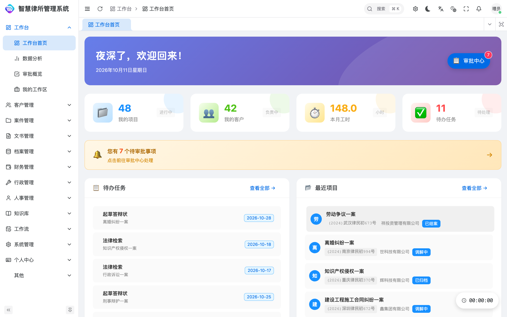
</p>

> 💡 **关于在线演示**：上方演示站点为本系统的「纯前端 + 浏览器内 Mock 数据」版本，无需后端即可完整体验全部界面与交互。有意获取**包含 Spring Boot 后端与生产级数据库**的完整商业源码，请见文末「获取与授权」。

> 🧱 本项目前端基于 **vue-vben-admin（Vben Admin）** 进行二次开发，在原企业级中后台脚手架之上，针对律师事务所业务场景定制了客户、案件、文书、档案、财务、行政、人事、知识库、审批流与数据报表等十大业务板块。

---

## ✨ 产品亮点

- **🧭 一体化工作台**：登录即可见全局数据看板——在办案件、本月营收、待办审批、客户增长一目了然。
- **👥 精细化客户管理**：客户档案、案源线索、利益冲突审查三管齐下，从源头规避执业风险。
- **⚖️ 全生命周期案件管理**：从立案、合同、任务到工时，案件进展全程留痕、责任到人。
- **📑 文书与用印闭环**：文书模板、在线拟稿、用印审批一体化，关键节点可审计、可追溯。
- **🗄️ 智能档案管理**：卷宗归档、借阅、销毁全流程电子化管理，调阅效率倍增。
- **💰 业财一体化财务**：合同、发票、收款、付款、报销、提成、财务报表，财务数据自动汇总。
- **🏢 行政人事一体化**：资产、会议室、采购、供应商、员工、薪资、绩效——事务所运转的后台基石。
- **📚 律所知识库**：法规、案例、实务文章沉淀为组织资产，新人培养与办案参考随手可得。
- **🔄 可配置审批流**：报告、用印、请假、外出等审批中心统一收口，流程透明可追踪。
- **📊 多维度数据报表**：营收、案件、客户、律师绩效多视角统计分析，辅助管理决策。

---

## 🧩 功能模块（十二大板块 · 80+ 页面）

> 以下菜单结构与生产库 `sys_menu` 完全一致（后端动态菜单，按角色授权），演示站按同一份数据渲染。

### 一、工作台
工作台首页 · 日程管理 · 审批中心

### 二、客户管理（CRM）
客户列表 · 利冲审查 · 案源管理

### 三、项目管理
项目列表 · 我的项目 · 合同管理 · 我的合同 · 任务管理 · 工时管理

### 四、财务管理
我的收款 · 我的提成 · 我的工资 · 费用报销 · 合同收款概览 · 收款管理 · 收款变更审批 · 提成管理 · 工资管理 · 发票管理 · 合同变更处理 · 预收款管理 · 合同模板 · 财务报表 · AI 费用账单

### 五、卷宗管理
我的文书 · 卷宗列表 · 文书制作 · 文书模板 · 卷宗模板

### 六、档案管理
档案列表 · 档案访问 · 档案迁移 · 档案推送状态

### 七、行政管理
考勤管理 · 请假管理 · 加班管理 · 外出管理 · 会议室预约 · 会议记录 · 出函管理 · 印章管理 · 用印申请 · 出函模板 · 资产管理 · 资产盘点 · 采购管理 · 供应商管理 · 合同查询

### 八、人力资源
员工档案 · 培训管理 · 绩效考核 · 转正管理 · 晋升管理 · 发展计划 · 离职管理 · 劳动合同

### 九、知识库
知识文章 · 案例库 · 法规库 · 质量管理

### 十、报表中心
业务报表 · 报表模板 · 定时报表

### 十一、数据交接
数据交接

### 十二、系统管理
用户管理 · 角色管理 · 部门管理 · 菜单管理 · 字典管理 · 权限矩阵 · 系统配置 · 操作日志 · 灾备管理 · 提成规则配置 · 系统公告 · 外部系统集成

---

## 📸 界面一览

> 以下截图均取自真实系统界面（演示数据），直观呈现各业务板块的实际效果。

| 模块 | 界面预览 |
|---|---|
| 👥 客户管理 | 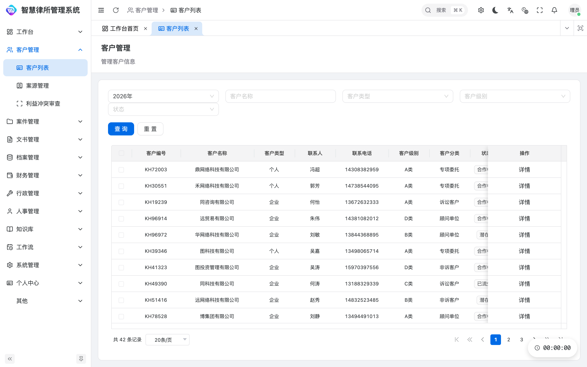 |
| ⚖️ 案件列表 | 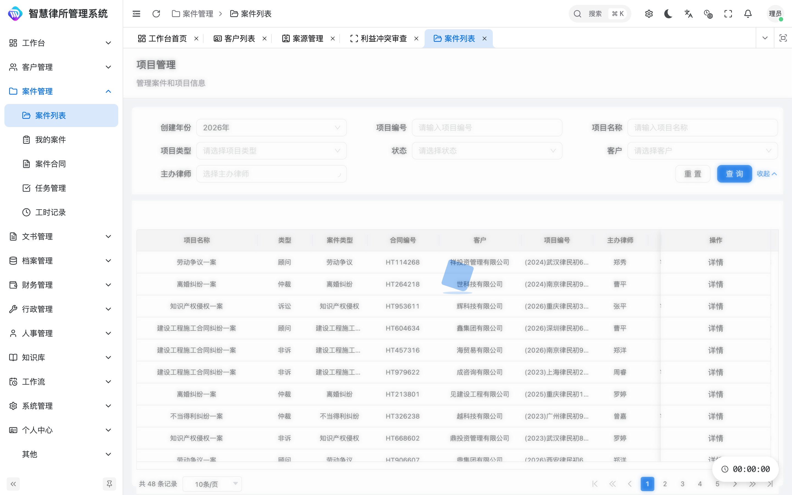 |
| 📑 案件合同 | 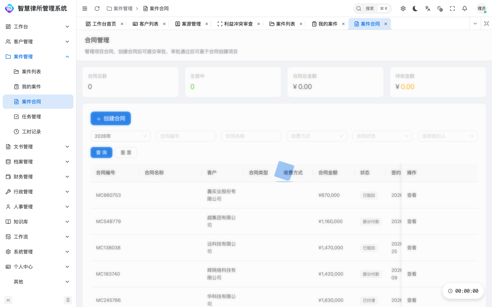 |
| 🗂️ 档案管理 | 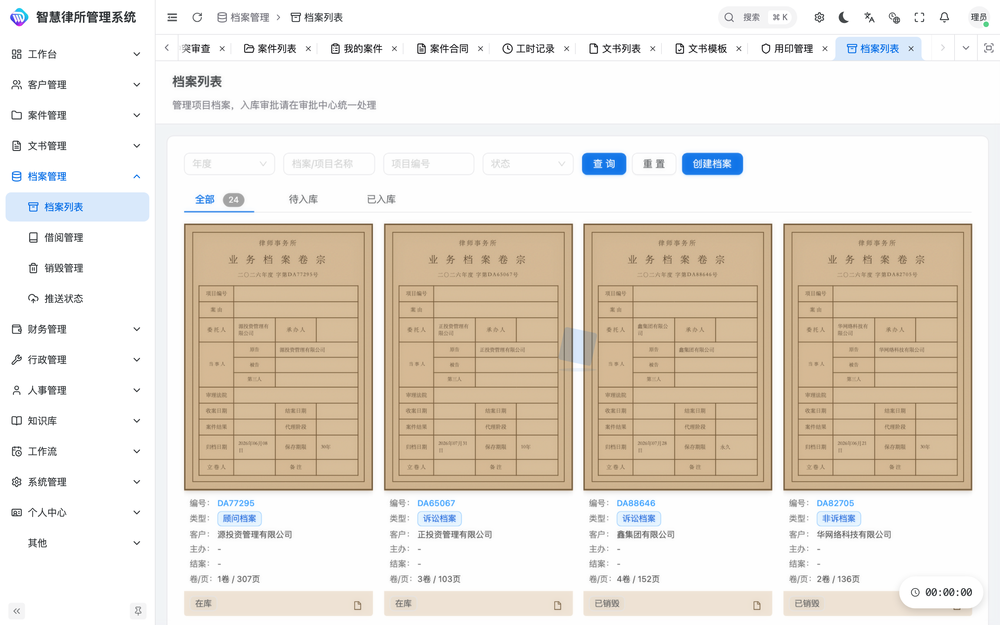 |
| 💰 财务合同 | 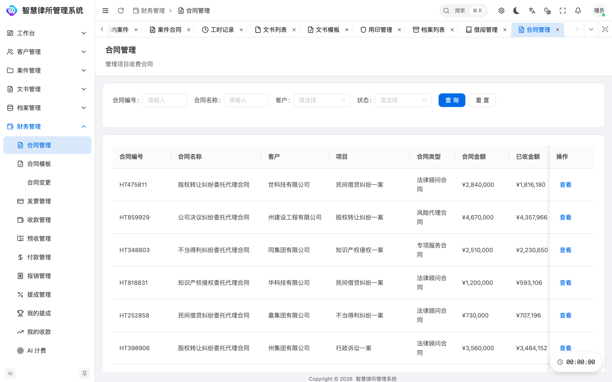 |
| 💸 财务报表 | 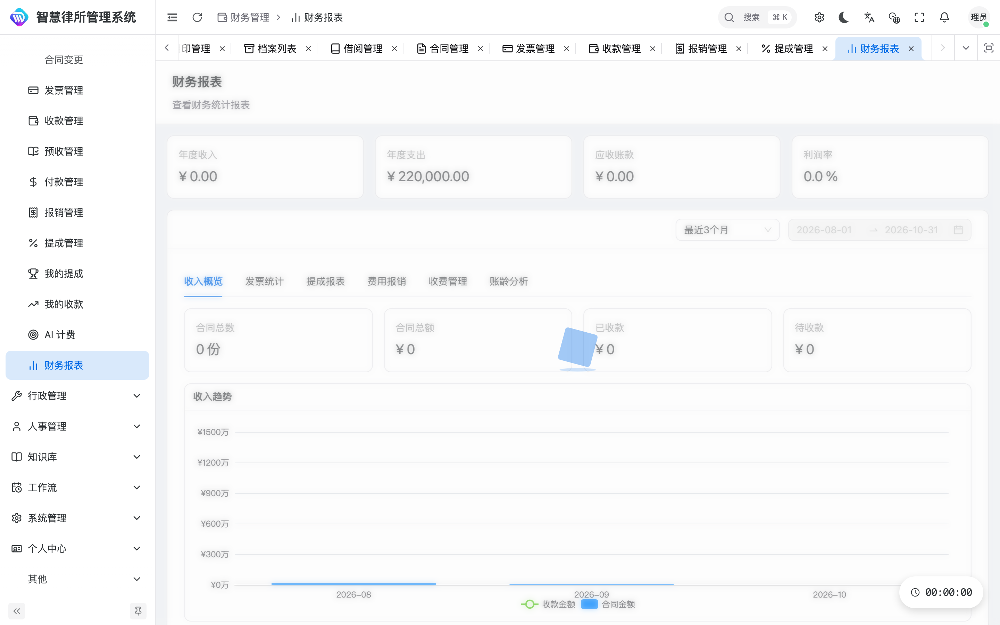 |
| 🏢 资产管理 | 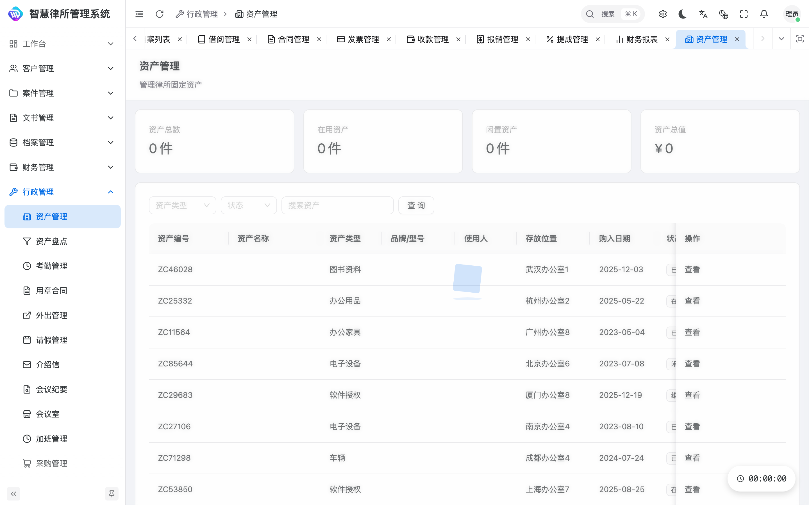 |
| 🛒 采购管理 | 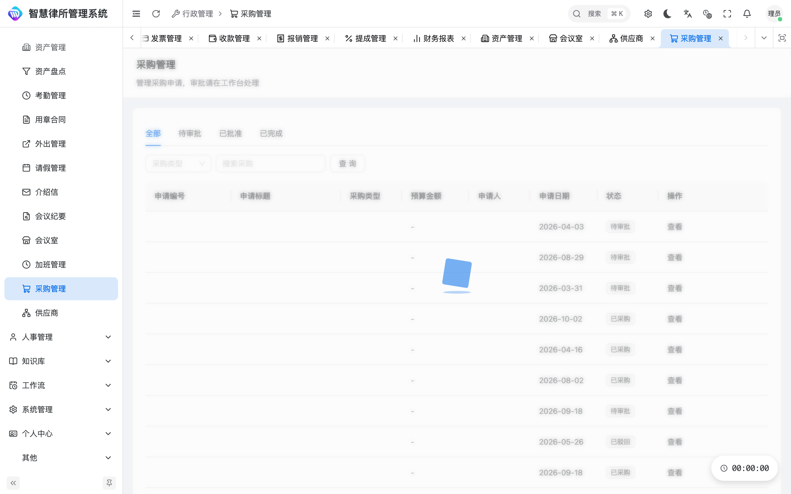 |
| 👨‍💼 人事员工 | 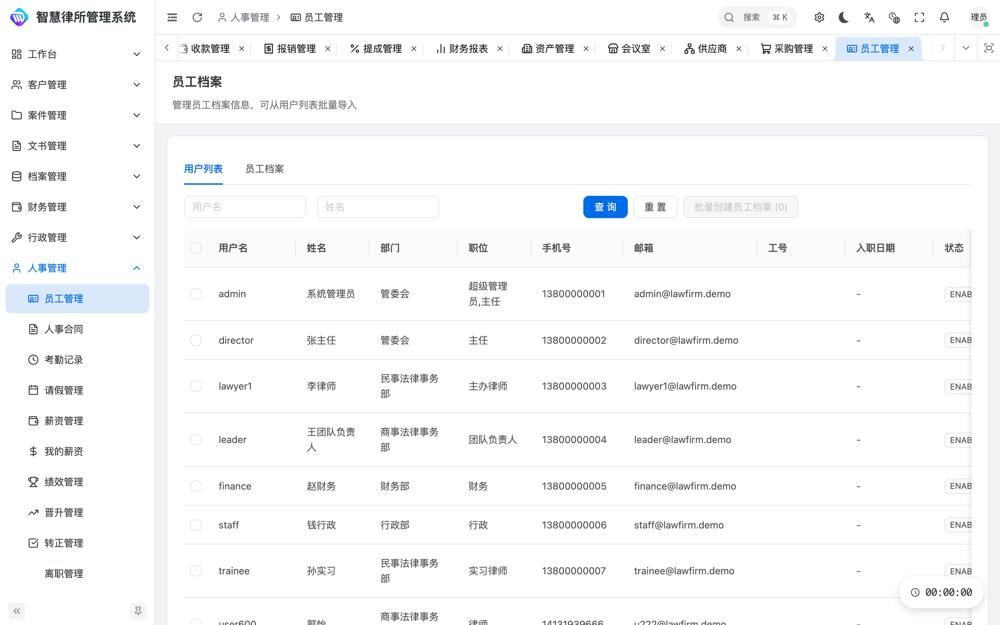 |
| 📚 知识库法规 | 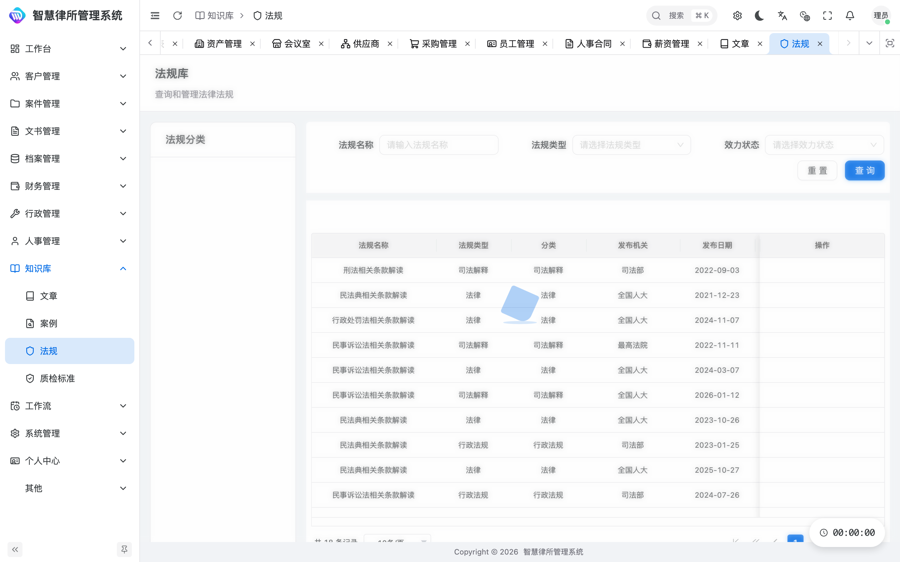 |
| 🔄 审批中心 | 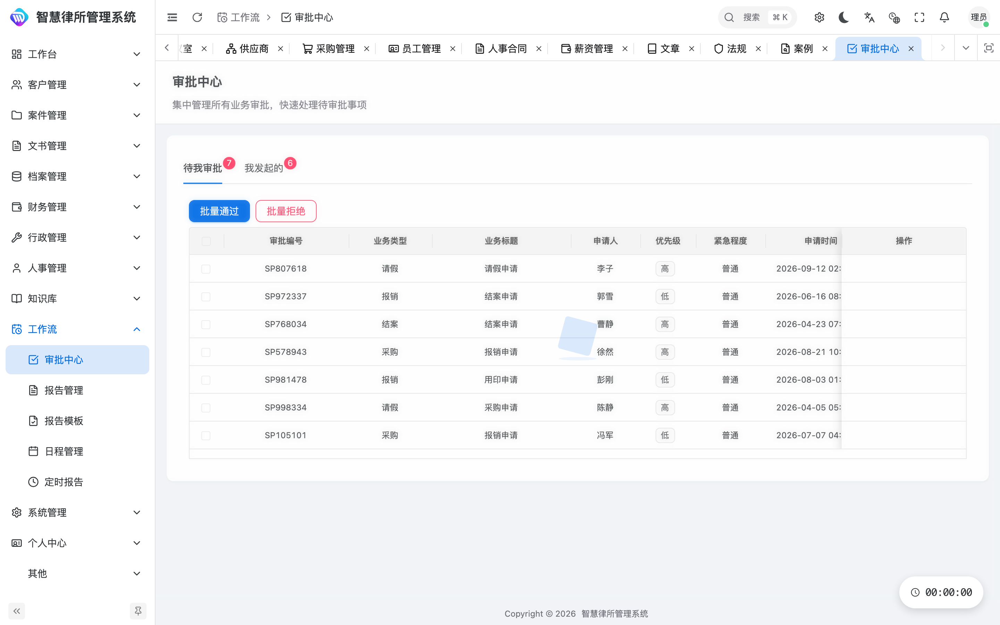 |
| 📊 数据分析 | 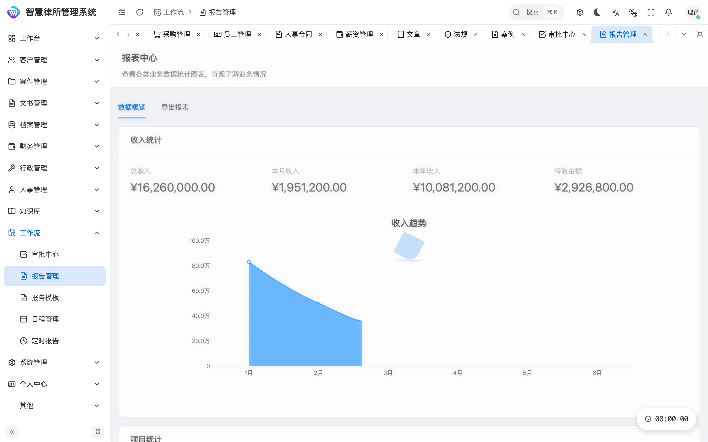 |

---

## 🚀 在线体验

访问 **[https://lawfirm.zhanjunyu.com/](https://lawfirm.zhanjunyu.com/)**，使用以下任意演示账号登录（密码均为 `123456`，滑动验证拖动即可通过）：

| 账号 | 角色 | 权限范围 |
|---|---|---|
| `admin` | 超级管理员 | 全部功能与系统设置 |
| `director` | 主任 | 全部权限 |
| `lawyer1` | 主办律师 | 案件 / 客户 / 合同 / 文书 |
| `leader` | 团队负责人 | 案件 / 客户 / 合同 |
| `finance` | 财务 | 合同 / 发票 / 报销 / 提成 |
| `staff` | 行政 | 资产 / 会议室 / 员工 |
| `trainee` | 实习律师 | 案件查看 |

> ⚠️ 演示站点为「前端 + 浏览器内 Mock 数据」，所见即真实界面；登录、增删改等交互均已打通，数据保存在浏览器本地，刷新不丢失，可随时「重置演示数据」。

---

## 🛠️ 技术架构

| 层级 | 技术选型 |
|---|---|
| 前端框架 | Vue 3 + TypeScript + Vite |
| UI 组件 | Ant Design Vue 4 + Vben Admin（企业级中后台脚手架） |
| 状态 / 请求 | Pinia + Axios + 统一响应拦截 |
| 权限模型 | 基于角色的访问控制（RBAC）+ 动态菜单 |
| 后端（完整版） | Spring Boot + MyBatis / JPA + MySQL |
| 部署形态 | 支持私有化部署 / 云部署；本演示为纯静态 + 浏览器内 Mock |

---

## 📦 仓库与源码说明

| 仓库 / 地址 | 性质 | 说明 |
|---|---|---|
| [lawfirm.zhanjunyu.com](https://lawfirm.zhanjunyu.com/) | 🌐 在线演示 | 本系统的「纯前端 ＋ 浏览器内 Mock 数据」版本，无需后端即可完整体验全部界面与交互。 |
| [`JunyuZhan/law-firm-demo`](https://github.com/JunyuZhan/law-firm-demo) | 🌐 公开 | 本演示站点源码（前端构建产物 ＋ 浏览器内 Mock 适配层 `sw.js`），即你正在浏览的在线 Demo。 |

> 本仓库（`law-firm-demo`）仅用于**产品展示与体验**，不含后端源码；如需获取**完整商业源码**（含 Spring Boot 后端、数据库脚本、部署文档），请通过文末方式联系开发者，源码以双方约定方式交付。

---

## 🔗 相关系统

同系列产品，可搭配使用或独立部署：

| 系统 | 在线演示 | 说明 |
|---|---|---|
| 🏛️ **智慧律所管理系统** | [lawfirm.zhanjunyu.com](https://lawfirm.zhanjunyu.com/) | 本系统——律所全流程数字化管理平台：客户、案件、财务、卷宗、行政、人事、知识库、审批、报表等十二大业务板块。 |
| 🗄️ **智慧律所档案管理系统** | [archivedemo.zhanjunyu.com](https://archivedemo.zhanjunyu.com/) | 电子档案全生命周期管理——接收、检索、借阅、鉴定、销毁、统计与运维管理。 |

> 两套系统可对接联动：本系统产生的案件与卷宗数据，可通过开放接口归档至档案管理系统，形成「业务办理 → 档案归档」的完整闭环。

---

## 👤 开发者

**junyuzhan（詹俊宇）**

- 📧 邮箱：<junyuzhan@outlook.com>
- 🐙 GitHub：[@JunyuZhan](https://github.com/JunyuZhan)
- 💼 专注企业级中后台系统与法律科技（LegalTech）产品研发

<p align="center">
  
  <br>
  <sub>📱 微信扫码添加开发者，咨询演示、报价与定制开发</sub>
</p>

---

## 💰 获取与授权

本系统提供**完整商业源码**（含 Spring Boot 后端、前端工程、数据库脚本、部署文档），适合律所信息化、法律科技二次开发、毕业设计 / 课程项目等场景。

- 📩 **商务合作 / 源码获取**：请邮件联系 <junyuzhan@outlook.com>，注明使用场景与需求。
- 💬 **微信咨询**：扫描下方二维码添加开发者微信，快速沟通演示、报价与定制需求。
- 🛠️ 支持私有化部署指导、功能定制、二次开发咨询。

<p align="center">
  
  <br>
  <sub>长按 / 扫码添加微信，备注「律所系统」优先通过</sub>
</p>

> 演示站点仅用于产品展示，不包含完整后端源码；最终交付以双方约定为准。

---

## ⚙️ 本地运行（演示版）

演示版为纯静态站点，使用 Service Worker 在浏览器内提供 Mock 接口，本地预览需通过 `localhost` 访问（Service Worker 要求安全上下文）：

```bash
# 在仓库根目录启动任意静态服务器
python3 -m http.server 8080
# 浏览器打开
open http://localhost:8080
```

首次打开后 Service Worker 会自动注册并接管 `/api` 请求；若登录页接口无响应，刷新一次页面等待 SW 激活即可。

---

## 📄 版权与免责

本仓库演示站点由前端构建产物与浏览器内 Mock 适配层组成，版权归开发者 **junyuzhan（詹俊宇）** 所有。未经授权不得用于商业转售；如需商用，请通过上述渠道获取正式授权。
